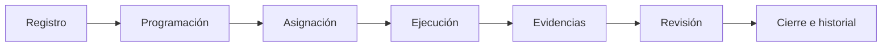
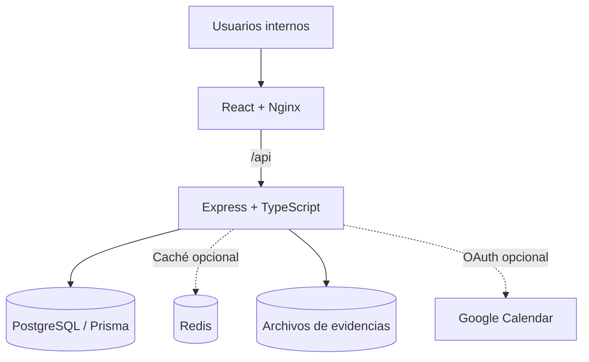

<div align="center">

# TrackOn
### Sistema web de gestión y trazabilidad de órdenes de trabajo

**Organiza, programa, asigna y supervisa las intervenciones de mantenimiento y reparación de equipos de refrigeración y climatización.**

Proyecto académico desarrollado para el contexto operativo de **MULTICAS S.A.**  
**Ingeniería de Sistemas · Universidad Nacional de Ingeniería (UNI)**

[](https://github.com/NuppyOz/TrackOn/actions/workflows/ci.yml)
[](https://sonarcloud.io/dashboard?id=NuppyOz_TrackOn)


[**Demostración en Azure**](https://trackon-web.politepebble-f2da20e8.westus.azurecontainerapps.io/) · [**Instalación**](#puesta-en-marcha-con-docker) · [**Arquitectura**](#arquitectura-y-tecnologías) · [**Documentación**](#documentación)

</div>

---

## ¿Qué es TrackOn?

**TrackOn** es una aplicación web interna que centraliza el seguimiento de órdenes de trabajo: desde su registro y programación hasta la ejecución técnica, revisión y cierre. Permite vincular intervenciones con clientes, ubicaciones, equipos, responsables y evidencias, de manera que la información operativa no quede dispersa.

> [!NOTE]
> La instancia de Azure es una **demostración académica** con acceso mediante credenciales autorizadas. No es un portal público para clientes ni debe interpretarse como un servicio empresarial listo para producción sin validaciones adicionales.

## Funcionalidades

| Área | Capacidades |
| :--- | :--- |
| **Órdenes de trabajo** | Registro, programación, asignación, consulta, seguimiento y cierre. |
| **Ejecución técnica** | Diagnóstico e intervenciones sobre equipos, servicios y materiales utilizados. |
| **Evidencias y trazabilidad** | Carga y revisión de evidencias, historial de estados y auditoría. |
| **Clientes y ubicaciones** | Administración de clientes y lugares de atención. |
| **Equipos** | Registro, identificación y asociación a ubicaciones. |
| **Empleados y cuadrillas** | Administración de personal técnico, cuadrillas y asignaciones. |
| **Supervisión** | Panel operativo, agenda y notificaciones. |
| **Acceso** | Autenticación, sesiones y permisos según el rol. |
| **Integración opcional** | Sincronización de agenda con Google Calendar mediante OAuth, según configuración. |

### Flujo operativo



Las acciones disponibles dependen del rol y del estado de la orden.

### Roles

| Perfil | Responsabilidad |
| :--- | :--- |
| **Administrador** (`ADMIN`) | Usuarios, configuración y supervisión. |
| **Gerente Operativo** (`GTE_OPE`) | Programación, asignación, seguimiento, revisión y cierre de órdenes. |
| **Técnico** (`TEC`) | Ejecución de trabajos asignados y registro de diagnósticos y evidencias. |

## Arquitectura y tecnologías

TrackOn se organiza como un **monorepositorio** con frontend React y API REST en un **monolito modular**.



| Capa | Herramientas |
| :--- | :--- |
| Interfaz | React 19, Vite, TypeScript, Bulma, Lucide |
| API | Node.js 24, Express 5, TypeScript, Zod |
| Datos | PostgreSQL 17, Prisma ORM |
| Acceso y comunicación | JWT, autorización por roles, WebSocket |
| Rendimiento | Redis opcional, worker threads |
| Infraestructura | Docker Compose, Nginx, Microsoft Azure Container Apps |
| Calidad | Vitest, Testing Library, GitHub Actions, SonarQube Cloud |

### Estructura del repositorio

```text
TrackOn/
├── apps/
│   ├── api/
│   │   ├── prisma/            # Esquema, migraciones y seeds
│   │   ├── src/               # API y módulos del negocio
│   │   └── test/              # Pruebas del backend
│   └── web/
│       ├── src/               # Pantallas, componentes y estilos
│       └── test/              # Pruebas del frontend
├── docs/                     # Documentación técnica
├── .github/workflows/        # Integración continua
├── compose.yaml              # Entorno Docker principal
├── compose.dev.yaml          # Servicios de desarrollo
├── compose.test.yaml         # Pruebas aisladas
└── README.md
```

## Puesta en marcha con Docker

**Requisitos:** Git, Docker Engine y Docker Compose.

**1. Clonar:**

```bash
git clone https://github.com/NuppyOz/TrackOn.git
cd TrackOn
```

**2. Preparar variables locales:**

```bash
cp .env.example .env
```

Revisa `.env` antes de arrancar. Cambia la contraseña de PostgreSQL y su valor correspondiente en `DATABASE_URL`; genera un `AUTH_ACCESS_TOKEN_SECRET` propio (por ejemplo, `openssl rand -hex 32`).

> [!IMPORTANT]
> `.env.example` contiene **valores ilustrativos**, no credenciales de producción. Nunca publiques archivos `.env`, secretos ni datos reales. Los scripts que crean usuarios de prueba se reservan para entornos de desarrollo.

**3. Construir e iniciar:**

```bash
docker compose up --build -d
docker compose ps
```

El entorno inicia PostgreSQL y Redis, ejecuta las migraciones con el servicio `migrate`, y levanta la API y la web. Para diagnosticar errores de migración: `docker compose logs migrate`.

**4. Abrir y verificar:**

- Aplicación: [http://localhost:8080](http://localhost:8080)
- Estado API + base de datos: [http://localhost:8080/api/ready](http://localhost:8080/api/ready)

```bash
curl http://localhost:8080/api/ready
docker compose logs --tail=100 api
```

Una respuesta disponible incluye `"status":"ok"` y `"database":"connected"`. El estado de Redis se informa por separado en `cache`.

**5. Detener conservando los datos:**

```bash
docker compose down
```

> [!CAUTION]
> **No ejecutes `docker compose down -v`** salvo que quieras eliminar explícitamente los volúmenes locales y sus datos.

<details>
<summary><strong>Desarrollo con recarga automática (Node.js + pnpm)</strong></summary>

Las versiones indicadas en `mise.toml` son **Node.js 24.22.1** y **pnpm 10.34.5**. La API puede correr con `tsx watch` y la web con Vite.

```bash
cp .env.example .env
cp apps/api/.env.example apps/api/.env
pnpm install --frozen-lockfile
docker compose -f compose.yaml -f compose.dev.yaml up -d db redis
```

Configura las URL y contraseñas en ambos archivos de entorno, usando `127.0.0.1` para la base local en `apps/api/.env`. Después, desde terminales independientes:

```bash
pnpm --filter @trackon/api exec prisma migrate deploy
pnpm --filter @trackon/api dev
```

```bash
pnpm --filter web dev
```

La web queda en `http://localhost:5173`. Consulta la [guía de desarrollo local](docs/desarrollo-local.md) para preparar cuentas y datos de prueba **sin tocar producción**.

</details>

## Calidad y pruebas

El workflow de [GitHub Actions](https://github.com/NuppyOz/TrackOn/actions/workflows/ci.yml) construye imágenes, aplica migraciones en una base de prueba aislada y ejecuta pruebas automatizadas. El análisis de [SonarQube Cloud](https://sonarcloud.io/dashboard?id=NuppyOz_TrackOn) se realiza cuando aplica.

```bash
pnpm typecheck
pnpm lint
pnpm test:web
```

Las pruebas de integración del backend **necesitan un PostgreSQL aislado**. Usa `compose.test.yaml` y el workflow como referencia; no ejecutes pruebas destructivas contra bases de datos reales.

## Documentación

| Recurso | Descripción |
| :--- | :--- |
| [Desarrollo local](docs/desarrollo-local.md) | Preparación, migraciones, usuarios de prueba y Vite. |
| [Docker](docs/docker.md) | Servicios, volúmenes y operación local. |
| [Backend y Prisma](docs/backend-prisma.md) | Organización interna y guía de módulos. |
| [SonarQube](docs/sonarqube-quality-gate.md) | Cobertura y Quality Gate. |
| [Google Calendar y tiempo real](docs/google-calendar-realtime.md) | OAuth, WebSocket y ejecución asíncrona. |
| [Redis y workers](docs/rendimiento-redis-workers.md) | Caché y tareas de procesamiento. |

> Parte de la documentación se redactó durante etapas iniciales. Para determinar el comportamiento vigente, consulta también el código, las migraciones y las pruebas de la rama correspondiente.

## Estado del proyecto

| Rama / entorno | Alcance |
| :--- | :--- |
| `main` | Núcleo integrado de gestión de órdenes utilizado como base de la demostración. |
| `dev` | Desarrollo colaborativo de módulos adicionales. Las funciones comerciales y de inteligencia de esta rama **no se presentan como integradas en `main`**. |
| Azure | Demostración académica con autenticación; requiere configuración y credenciales propias. |

**Pendientes para un uso empresarial:** almacenamiento persistente de evidencias fuera del contenedor, conectividad estable con PostgreSQL, recuperación verificada de respaldos y pruebas operativas de seguridad y disponibilidad.

## Colaboración

Usa ramas y pull requests para proponer cambios. Incluye pruebas para nuevas funcionalidades, revisa las migraciones Prisma cuando cambie el modelo de datos y nunca subas credenciales, datos personales de clientes ni evidencias sensibles.

[Contribuidores](https://github.com/NuppyOz/TrackOn/graphs/contributors) · [Pull requests](https://github.com/NuppyOz/TrackOn/pulls) · [Historial de cambios](https://github.com/NuppyOz/TrackOn/commits/main)

---

<div align="center">

**TrackOn · MULTICAS S.A.**  
*Proyecto académico — Ingeniería de Sistemas · Universidad Nacional de Ingeniería*

</div>
